# Mandelbrot.Visualizer

An interactive viewer for 2D escape-time fractals (the Mandelbrot set and its relatives) and 3D signed-distance-field (SDF) raymarched fractals (Mandelbulb and Mandelbox). In 2D, every pixel asks the same question: if you follow the rule `z = z^n + c` over and over, do the numbers stay finite or run off to infinity? In 3D, a GPU raymarcher traces rays through volumetric fractal geometry with physically based lighting, soft shadows, atmospheric fog, and optional thin-lens depth of field.

`n` can be any real number, not only 2. The panel edits the power, the iteration limit, the coloring, and whether you are looking at a Mandelbrot-style map, a Julia set, or a 3D Mandelbulb / Mandelbox. The 2D picture can be drawn on the CPU or with a GPU shader; 3D mode runs on a progressive GPU raymarching shader with `Fast (low-end)`, `Balanced`, and `High` quality tiers.

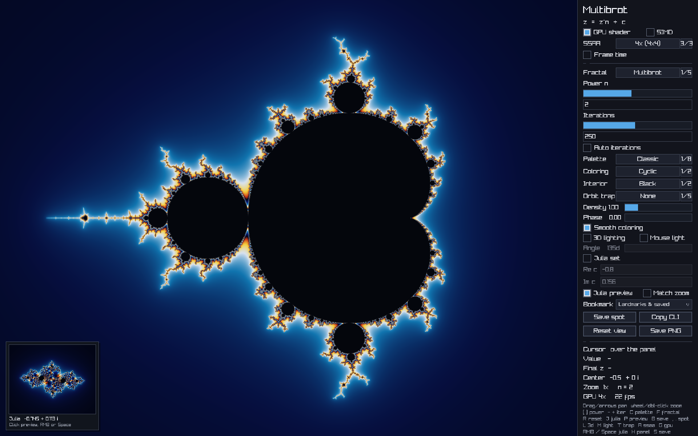

## Gallery

### 3D SDF Raymarching (Mandelbulb & Mandelbox)

Press `3` (or toggle **3D Bulb** / pass `--mandelbulb` or `--mandelbox`) to switch into the real-time 3D raymarcher with Orbit and 6DOF Fly cameras, GGX PBR materials, headlamp, depth fog, crevice glow, and progressive thin-lens depth of field:

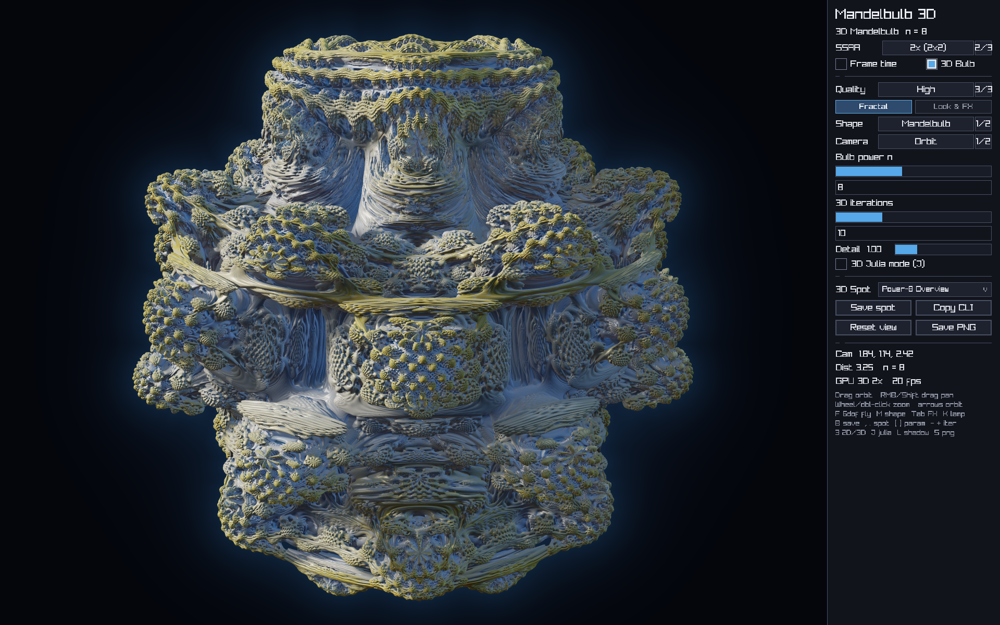

| | |
| :---: | :---: |
| 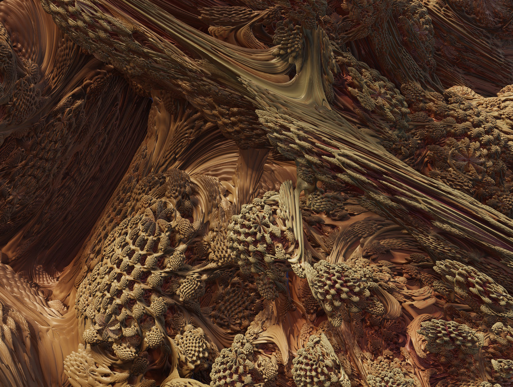<br>**6DOF Fly Camera** - `Canyon Fly-Through` 3D landmark captured inside a Power-8 Mandelbulb canyon | 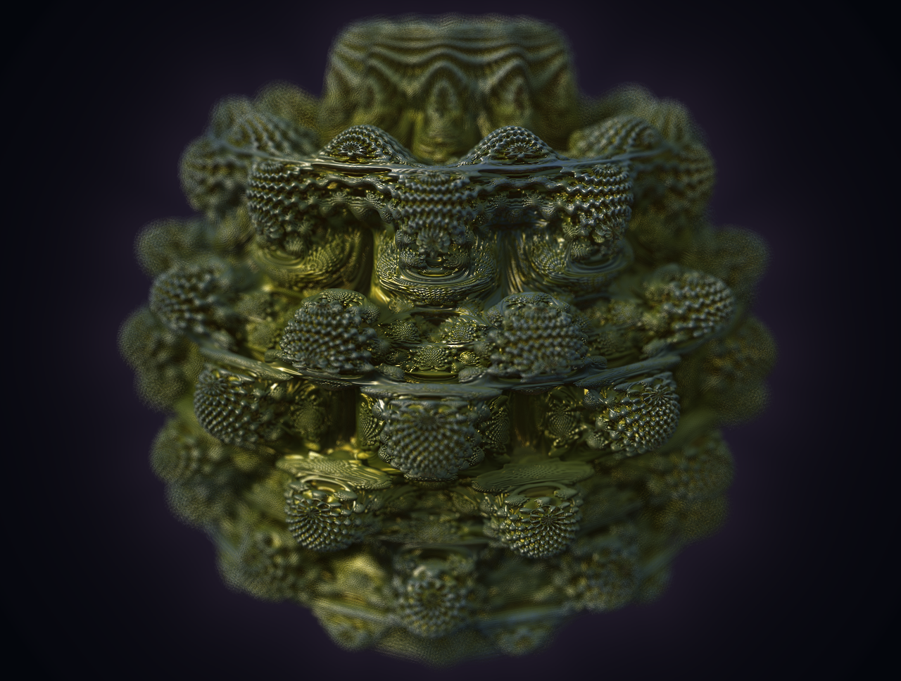<br>**PBR Metals & Thin-Lens DoF** - `Sea Urchin` 3D landmark with `--dof 0.08` progressive bokeh accumulation |
| 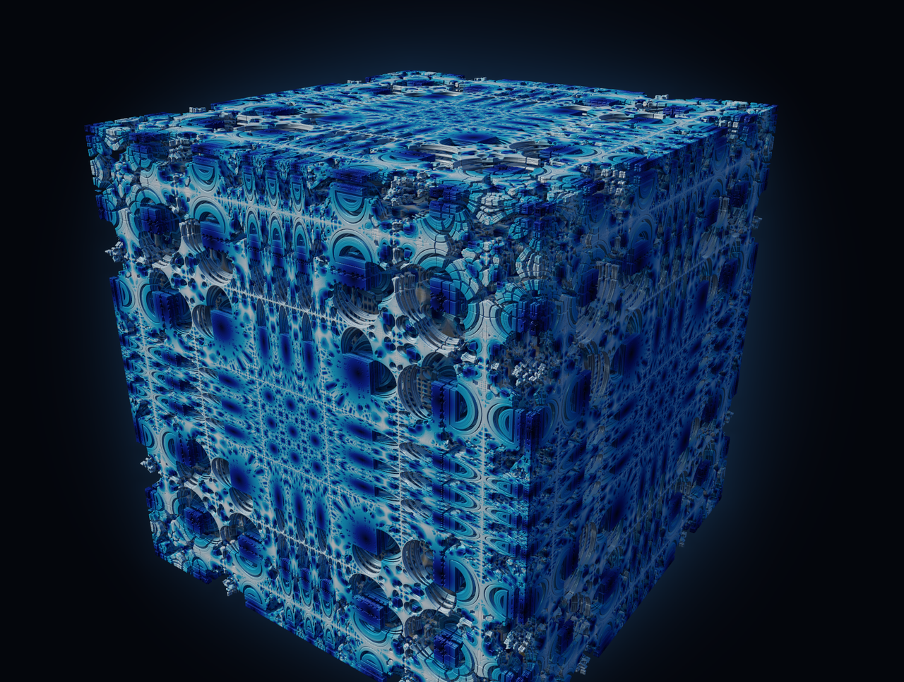<br>**3D Mandelbox** - `Classic Mandelbox` (`scale = 2.0`, `min rad = 0.5`, `fold = 1.0`) with soft shadows & AO | 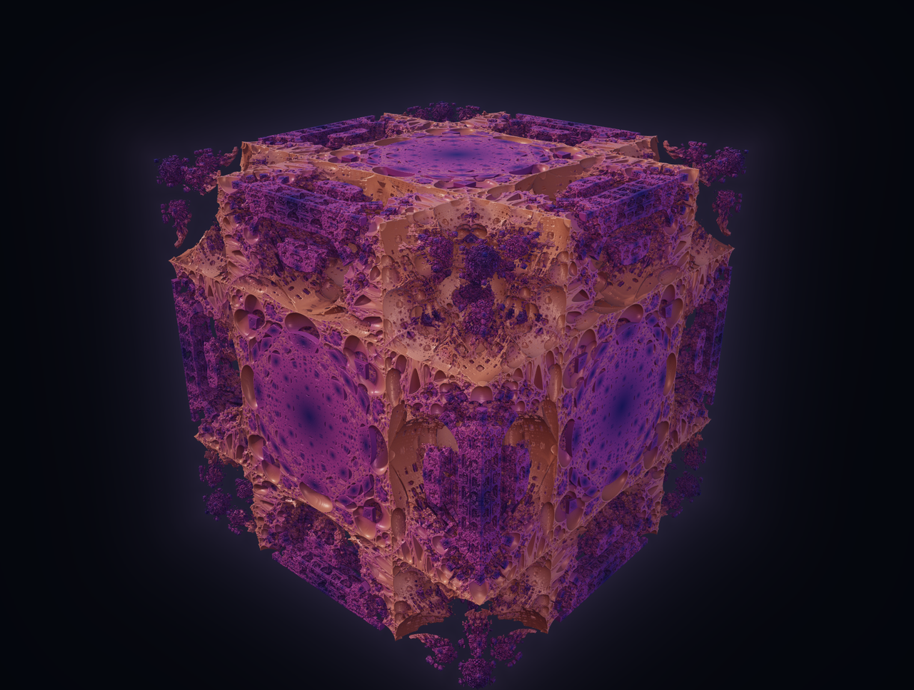<br>**Headlamp & Aerial Depth Fog** - `Architectural Lattice` (`scale = -1.5`) with `--headlamp --fog 0.22` |

### 2D Escape-Time Fractals

All captures below were rendered directly by `Mandelbrot.Visualizer` with automatic `4x` RGSS supersampling:

| | |
| :---: | :---: |
| 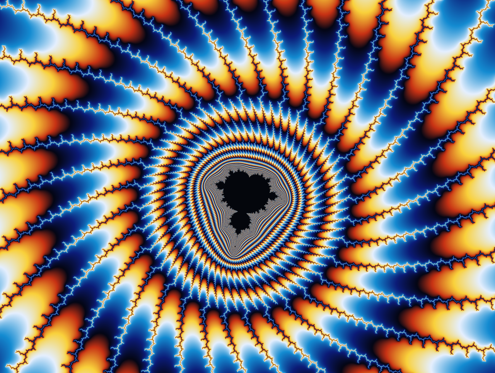<br>**Deep-zoom perturbation (`1.35e+30x`)** - `Mini-brot (1e-30)` bookmark rendered via `BigFloat` reference orbit + Zhuoran rebasing | 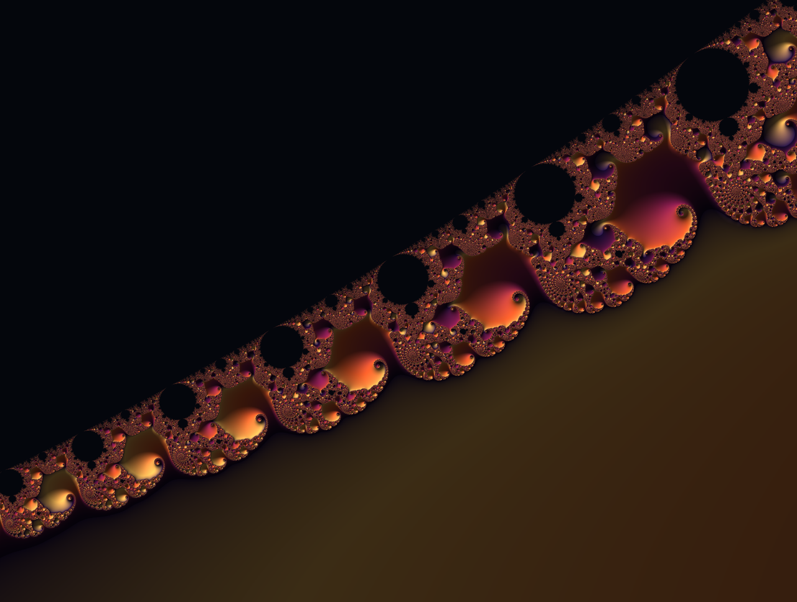<br>**3D normal-map lighting** - `Elephant Valley` bookmark with `--lighting --angle 135` |
| 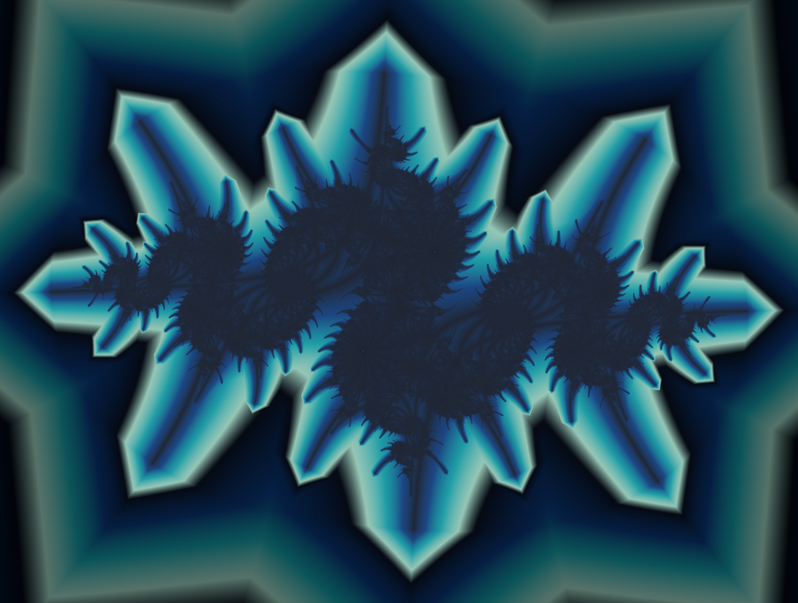<br>**Orbit traps & glow interior** - `Julia: Spiral` bookmark with `--trap cross --interior glow --palette Ocean` | 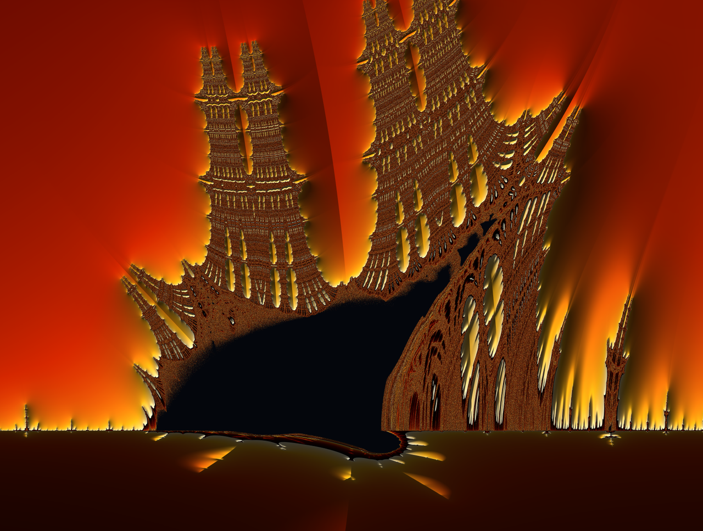<br>**Burning Ship family** - `Burning Ship: Armada` bookmark with `--lighting --angle 120` |
| 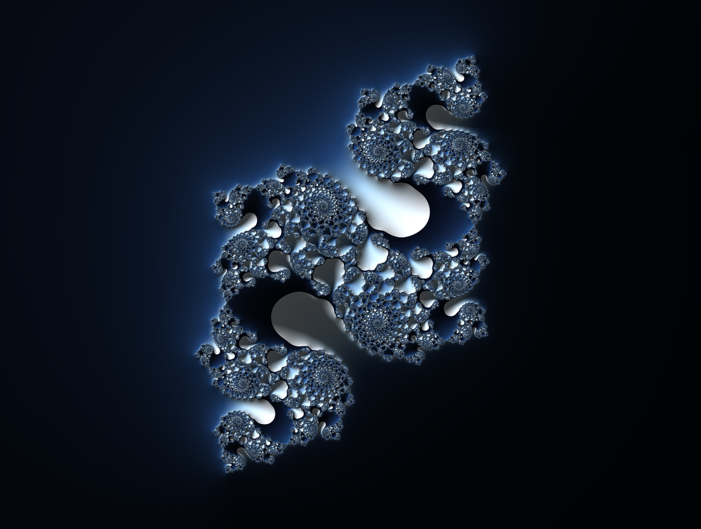<br>**Tricorn Julia set** - `Tricorn Julia: Crystalline Web` bookmark with 3D lighting | 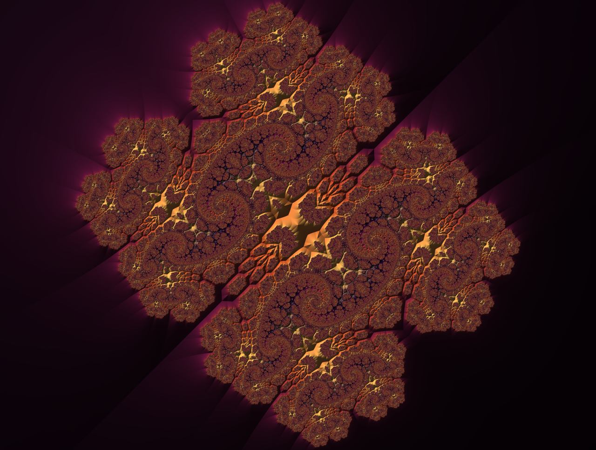<br>**Celtic Julia set** - `Celtic Julia: Braided Cross` bookmark with 3D lighting |

## Capabilities

- **3D SDF Raymarching (`3` / `--mandelbulb` / `--mandelbox`)**:
  - Explore real-time 3D **Mandelbulb** (power `2` to `16`), **Mandelbox** (`scale`, `Min rad`, `Fold`), and **3D Julia** sets with progressive tiled final frames, half-resolution interactive preview, and `2x`/`4x` RGSS supersampling.
  - Switch seamlessly (`F`) between an **Orbit** camera and a gimbal-lock-free quaternion **6DOF Fly** camera with smooth per-axis acceleration/deceleration, instant mouse look, roll (`Q`/`E`), horizon leveling (`X`), and automatic SDF distance-adaptive flight speed so flying near micro-detail automatically slows down.
  - Tune surface look in the **Look & FX** tab (`Tab`): Cook-Torrance GGX PBR materials (`Roughness`, `Metallic`, analytic environment reflections), directional key light elevation (`Light el`), camera-mounted **Headlamp** (`K`), exponential aerial-perspective **Depth Fog**, orbit-trap crevice **Glow**, soft SDF shadows (`L`), and optional progressive **Thin-Lens Depth of Field** (with automatic center-ray SDF autofocus or manual focus distance).
  - Three GPU **Quality** tiers (`Fast (low-end)`, `Balanced`, `High`) scale march steps, ambient occlusion taps, shadow rays, and DoF samples so both integrated GPUs and high-end cards stay responsive.
  - **20 curated 3D landmarks** (14 Mandelbulb + 6 Mandelbox) persisted in `mandelbulb-bookmarks.json`, plus custom 3D spot saving (`B` / `Save spot`), `,`/`.` cycling, and one-click `Copy CLI`.
- Switch between five 2D fractal families (`Multibrot`, `Burning Ship`, `Tricorn`, `Celtic`, `Buffalo`) with full support for arbitrary power `n`, Julia sets, 3D lighting (2x2 real Jacobian normals), orbit traps, and cursor probing.
- Pan, zoom, and reset the view with arbitrary-depth zoom for Mandelbrot (`n = 2`), positive whole-number Multibrot (`n = 2..16`), and Julia sets.
- Set the power `n` from the slider (`-6` to `12`), type any finite number, or hold `[` and `]` to sweep it.
- Choose `1` to `100,000` iterations (logarithmic slider, text box, or `-`/`+`), or toggle **Auto iterations** to scale the limit with zoom depth.
- Inspect the point under the cursor live in the side panel: complex coordinate (`Cursor`), escape iteration / smooth value or interior magnitude (`Value`), and final complex value (`Final z`), including at deep zoom.
- Color by how fast a point escapes: cyclic bands or a histogram, with optional smoothing, density, and phase.
- Optional **3D lighting** (directional normal-map shading with a 360-degree angle slider, or **Mouse light** mode using the cursor as a live floating point light) and optional **Orbit traps** (`Point`, `Cross`, `Circle`, `Square`), working across both GPU shaders (including deep-zoom perturbation) and CPU.
- Eight palettes shared directly between CPU and GPU via a baked LUT: Classic, Fire, Electric, Ocean, Sunset, Ice, Grayscale, Rainbow.
- Paint the interior solid or with a glow based on the smallest size the orbit reached.
- Switch to a Julia set and type the constant `c`, or enable the optional **Julia preview** corner overlay (`P`) to preview the Julia set for the cursor's `c` live and jump straight into it with a click on the preview, right-click, or `Space` (optionally with **Match zoom** to keep the same zoom level for both preview and jump, and returning to your previous map view with a left-click or right-click on the canvas or by toggling `J`).
- Draw with tiered GPU fragment shaders (native float32, double-float, and deep-zoom perturbation with progressive tiling and idle frame caching), or switch to the CPU backend with orbit caching for instant recoloring. Histogram coloring always uses the CPU.
- Optional **2x / 4x SSAA** (`2x2` / `4x4` rotated-grid supersampling, hotkey `A` or `--ssaa`) on final frames across both GPU and CPU to eliminate sparkling moire noise on ultra-dense filaments while keeping interactive panning/zooming at 1x speed. Saving a PNG (`Save PNG` / `S`) or capturing via `--screenshot` automatically uses the highest SSAA tier (`4x`) and restores your interactive SSAA setting afterward.
- **Bookmarks & curated landmarks** (`bookmarks.json`): jump to 25 curated spots across all five fractal families (including Seahorse Valley, Elephant Valley, Scepter Valley, Mini-brot at `1e-30`, classic Julia sets, Burning Ship Armada, and family Julia sets), save your own deep-zoom locations with a custom or auto-generated name (`B` or `Save spot`), cycle through all bookmarks with `,` / `.` (or `PageUp` / `PageDown`), and copy a reproducible deep-zoom launch command with **Copy CLI**.
- Optionally evaluate positive whole-number powers with AVX2 / AVX-512 SIMD (FMA + lane refilling) on the CPU.
- Optionally show how long the newest image took to generate.
- Save the current picture as a PNG under `captures/`, or render headlessly from the command line with `--screenshot`.

## The math, simply

### A point is two numbers

A complex number is just a pair: how far left or right, and how far up or down. Adding two of them adds each part. Multiplying them both stretches and turns. That is the whole machine the fractal runs on.

### One step

Start with some `z`. Replace it by

```text
z  =  z^n  +  c
```

Do that again with the new `z`. And again.

Each step feeds the previous result back in. After enough steps, one of two things happens:

- The size of `z` stays modest forever. Call that point **inside**.
- The size of `z` grows without bound. Call that point **outside**.

"Forever" is impractical, so the program stops early. If the size passes 16, the point counts as outside. If that has not happened after the iteration limit, the point counts as inside. Raising the iteration limit rechecks the stubborn points that grow very slowly.

The color of an outside point comes from how many steps it took to pass 16. Smoothing uses the size on the escaping step so the count is not stuck on whole numbers. Histogram coloring ranks points by that count across the whole picture. The interior is either left dark, or shaded by the smallest size `z` reached along the way.

## The fractals

Same rule. The fractals differ in what is fixed and what the pixel means.

### Mandelbrot set

This is `n = 2`, so the rule is `z = z² + c`.

Every pixel is a different `c`. Everyone starts at `z = 0`.

So the picture is a map of addition constants. A pixel is inside when "start at nothing, then keep squaring and adding this pixel" never blows up. It is outside when that process eventually does.

Squaring a complex number doubles its turn and squares its length. Adding `c` then shifts the result by the pixel. Those two moves, repeated, are the whole definition.

### Multibrot sets

Change `n` and you get the same kind of map for a different power: `z = z^n + c`, still starting from `z = 0`, still using the pixel as `c`.

`n = 2` is the Mandelbrot set. `n = 3` cubes instead of squares. `n = 4` raises to the fourth. Any other whole number from `-16` to `16` is the same idea: multiply the complex number by itself that many times, then add `c`.

A whole-number power is exact multiplication. No angles are required. `n = 1` is only `z = z + c`, which walks in a straight line and almost everything escapes. `n = 0` replaces `z` by `1 + c` every step.

### Fractional powers

`n` does not have to be a whole number. `1.4` is allowed.

A complex number can be written as a length and a direction (an angle). Raising it to the power `n` raises the length to `n`, and multiplies the angle by `n`:

```text
(length, angle)  ->  (length^n, n * angle)
```

That matches whole-number powers, and it also works for fractions. `1.4` means "make the length a bit more than itself, and turn the angle by 1.4 times."

Angles are measured from the positive rightward direction, and they jump when you cross the leftward direction. That jump is a branch cut. For a fractional `n`, crossing it changes the result, because a fraction of a turn does not land on the same place from both sides. Whole-number powers do not have this seam, because a whole number of turns brings you back to the same direction.

Very deep zooms of a fractional power are less precise than whole-number powers. The GPU evaluates that polar form in ordinary single precision. Whole-number powers switch from float32 to double-float and then to arbitrary-precision perturbation so you can keep zooming far past standard floating-point limits.

### Deep zoom (perturbation)

Standard 64-bit floating-point numbers run out of precision around `1e-15`. Computing every pixel in full arbitrary-precision arithmetic would be too slow for interactive exploration.

Instead, once zoom passes `1e-12` (for integer powers `n = 2..16` and Julia sets), the viewer computes a single high-precision **reference orbit** `Z` off-thread using arbitrary-precision `BigFloat` math, then iterates only the tiny difference `dz` from that reference orbit for every pixel on the GPU or CPU. Zhuoran rebasing resets `dz` whenever a pixel drifts too far from the reference orbit to prevent glitches, and extended-exponent numbers (`FloatExp` / `ComplexExp`) keep tracking offsets well past `1e-38` and `1e-308`.

### Julia sets

Turn on Julia and the question flips.

`c` is now one fixed number for the entire picture (by default `-0.8 + 0.156i`). Each pixel is the **starting** `z`, not the thing you add.

Inside means: "if I start at this pixel and keep doing `z = z^n + c` with this same `c`, I stay finite."

You can type both parts of `c`. Changing `c` changes which starts survive. Changing `n` still changes the power inside the same rule. The Mandelbrot map and a Julia set are two readings of one formula: either the pixel chooses `c` and you start at zero, or `c` is chosen and the pixel chooses the start.

### Other fractal families

Use the **Fractal** selector (or `F` / `--fractal`) to explore four classic escape-time relatives alongside `Multibrot`, all supporting arbitrary power `n`, Julia mode, orbit traps, and 3D lighting:

- **Burning Ship**: `z = (|Re z| - i|Im z|)^n + c`
- **Tricorn (Mandelbar)**: `z = conj(z)^n + c`
- **Celtic**: `z = |Re(z^n)| + i Im(z^n) + c`
- **Buffalo**: `z = |Re(z^n)| - i|Im(z^n)| + c`

### Negative powers

A negative `n` includes a reciprocal. `z^-1` is `1/z`, and more negative integers are that idea repeated. After the power, the formula still adds `c`.

Points that pass through zero are special, because dividing by zero is undefined. Those orbits stop there.

### 3D SDF fractals (Mandelbulb & Mandelbox)

Press `3` (or check **3D Bulb**) to explore volumetric 3D fractals rendered with GPU sphere tracing (signed distance field raymarching):

- **Mandelbulb**: generalizes the Mandelbrot set to 3D using spherical coordinates (`r`, `theta`, `phi`), scaling the radius to `r^n` and multiplying both polar and azimuth angles by `n` before adding `c` (with `n = 8` as the classic form, or any power from `2` to `16`).
- **Mandelbox**: alternates a box fold (`clamp` / reflect each axis across `±fold`) with a sphere fold (inverting points inside `Min rad`..`1`) and a uniform scaling factor `scale`, producing architectural lattices, cathedrals, and cavernous chambers.
- **3D Julia sets**: toggle **3D Julia mode** (`J`) on either shape to fix `c` across space and iterate from each 3D sample position.

Because the distance estimator bounds how far a ray can safely step without hitting the surface, the same SDF powers soft shadows, multi-tap ambient occlusion, Cook-Torrance GGX PBR lighting, center-ray autofocus for thin-lens depth of field, and automatic distance-adaptive flight speed in 6DOF Fly mode.

## Run

You need the .NET 11 SDK.

```bash
dotnet run -c Release --project src/Mandelbrot.Visualizer.csproj
```

> **Note: Always prefer `-c Release` for real exploration and benchmarking.**
> By default, `dotnet run` builds in `Debug` configuration, which disables RyuJIT optimizations, method inlining, bounds-check elimination, and hardware register allocation for `Vector256` / `Vector512` SIMD values. In `Debug`, SIMD registers are spilled to the stack on every iteration and tight inner loops (`SimdMultibrot` AVX2 / AVX-512 + FMA paths, `BigFloat` reference orbits, perturbation arithmetic, histogram coloring, and CPU `4x` SSAA) run many times slower. Passing `-c Release` enables full JIT optimization so SIMD intrinsics stay in vector registers and the renderer runs at full performance.

Run the headless verification suite (checks known points, SIMD parity, palette LUT endpoints, `BigFloat`/`FloatExp`/`ComplexExp` math, deep-zoom perturbation parity at `1e-25` and `1e-80`, cursor orbit probing, 3D lighting and orbit traps, fractal families, Julia preview jump/return matrix, SSAA, 3D Mandelbulb/Mandelbox SDF + 6DOF camera + PBR/DoF + 20 curated landmarks, and bookmarks JSON/CLI round-trips):

```bash
dotnet run -c Release --project src/Mandelbrot.Visualizer.csproj -- --self-test
```

You can also launch directly to a 2D bookmark, a 3D Mandelbulb / Mandelbox landmark, a custom deep-zoom location, or capture a PNG from the command line:

```bash
# 2D deep-zoom bookmark
dotnet run -c Release --project src/Mandelbrot.Visualizer.csproj -- \
  --bookmark "Mini-brot (1e-30)"

# 3D Mandelbulb with thin-lens depth of field
dotnet run -c Release --project src/Mandelbrot.Visualizer.csproj -- \
  --bulb-spot "Sea Urchin" --bulb-quality high --dof 0.08

# 3D Mandelbox with headlamp and atmospheric depth fog
dotnet run -c Release --project src/Mandelbrot.Visualizer.csproj -- \
  --bulb-spot "Architectural Lattice" --bulb-quality high --headlamp --fog 0.22

# Headless 2D deep-zoom PNG capture
dotnet run -c Release --project src/Mandelbrot.Visualizer.csproj -- \
  --center -0.743643887037158704752191506114774,0.131825904205311970493132056385139 \
  --scale 1e-25 --power 2 --iter 1500 --screenshot captures/deep.png
```

Supported CLI options:

- `--self-test` - run headless math and parity checks and exit
- `--bookmark name` - start at a curated or saved 2D bookmark from `bookmarks.json` (matches exact or partial name; additional flags override fields)
- `--center re,im` - starting complex center (supports arbitrary decimal digits)
- `--scale value` - starting viewport half-height (supports scientific notation like `1e-45`)
- `--power n` - starting exponent `n` (2D power or 3D Mandelbulb power)
- `--fractal family` - starting 2D fractal family (`multibrot`, `burningship`, `tricorn`, `celtic`, `buffalo`)
- `--julia re,im` - start in 2D Julia mode with constant `c = re + im*i`
- `--iter count` - starting max iterations (`1` to `100000` in 2D, `2` to `32` in 3D)
- `--palette name` - starting palette (`Classic`, `Fire`, `Electric`, `Ocean`, `Sunset`, `Ice`, `Grayscale`, `Rainbow`)
- `--coloring mode` - 2D coloring mode (`cyclic`, `histogram`)
- `--density value` - palette density (`0.25` to `4.0`)
- `--phase value` - palette phase offset (`0.0` to `1.0`)
- `--cpu` - start with the CPU renderer instead of GPU shaders (2D mode)
- `--fullscreen` - launch directly in fullscreen mode
- `--lighting` / `--3d` - enable 2D 3D normal-map lighting
- `--angle deg` - set 2D light azimuth angle in degrees (`0` to `360`, implies `--lighting`)
- `--mouse-light` - use the mouse pointer as a floating 2D point light (implies `--lighting`)
- `--light x,y` - fix the 2D point light at normalized canvas coordinates (implies `--mouse-light`)
- `--trap mode` - enable a 2D orbit trap (`none`, `point`, `cross`, `circle`, `square`)
- `--interior style` - set 2D interior style (`black`, `glow`)
- `--julia-preview` - start with the corner live Julia preview enabled
- `--match-zoom` - use the current map zoom level for both the Julia preview and one-click Julia jump
- `--preview-c re,im` - pin the corner live Julia preview to a specific `c` (implies `--julia-preview`)
- `--mandelbulb` - start directly in 3D SDF Mandelbulb mode
- `--mandelbox` - start directly in 3D SDF Mandelbox mode
- `--bulb-spot name` - start at a curated or saved 3D landmark from `mandelbulb-bookmarks.json` (implies `--mandelbulb`)
- `--fly` - start 3D mode in gimbal-lock-free 6DOF Fly camera mode
- `--bulb-camera yaw,pitch,dist` - set 3D Orbit camera yaw/pitch (degrees) and distance
- `--bulb-target x,y,z` - set 3D Orbit camera target point
- `--bulb-pos x,y,z` - set 3D Fly camera position (implies `--fly`)
- `--bulb-ypr yaw,pitch,roll` - set 3D Fly camera orientation in degrees (implies `--fly`)
- `--bulb-detail value` - set 3D surface detail multiplier (`0.25` to `4.0`)
- `--bulb-julia x,y,z` - enable 3D Julia mode with constant `c = (x, y, z)`
- `--box-scale value` - set Mandelbox scale factor (`-3.5` to `3.5`)
- `--box-min-radius value` - set Mandelbox sphere-fold min radius (`0.1` to `1.0`)
- `--box-fold value` - set Mandelbox box-fold limit (`0.5` to `2.0`)
- `--bulb-quality tier` - set 3D GPU quality tier (`fast`, `balanced`, `high`)
- `--light-el deg` - set 3D key light elevation angle (`-30` to `85`)
- `--headlamp` - enable the 3D camera-mounted headlamp
- `--fog amount` - set 3D exponential depth fog density (`0.0` to `1.0`)
- `--roughness value` - set 3D PBR surface roughness (`0.05` to `1.0`)
- `--metallic value` - set 3D PBR metallic factor (`0.0` to `1.0`)
- `--glow amount` - set 3D orbit-trap crevice glow (`0.0` to `1.0`)
- `--dof aperture` - enable 3D progressive thin-lens depth of field with aperture radius (`0.0` to `0.15`)
- `--focus dist` - set manual 3D DoF focus distance (disables autofocus; implies `--dof` if not set)
- `--no-shadows` - disable 3D soft SDF shadows
- `--bulb-fx-tab` - start 3D mode with the **Look & FX** panel tab active
- `--ssaa mode` - enable optional final-frame and capture supersampling (`off`, `2x`, `4x`)
- `--screenshot path.png` - render a final-quality frame (automatically using highest `4x` SSAA unless `--ssaa` is explicitly set), save it (plus a `.window.png` capture), and exit

Pictures saved interactively from the app go to `captures/` (named after the active bookmark title when a bookmark is selected, with automatic `-2`, `-3` suffixes to avoid overwriting).

## Controls

### 2D Mode

| Action | Control |
| --- | --- |
| Pan | Drag, or the arrow keys |
| Zoom | Mouse wheel. Hold Shift and Up to zoom in, Shift and Down to zoom out. Double-click zooms in. Shift double-click zooms out |
| Power `n` | Slider, text box, or hold `[` and `]`. A tap steps by 0.1 |
| Fractal | Combo box (`Multibrot`, `Burning Ship`, `Tricorn`, `Celtic`, `Buffalo`), or `F` to cycle |
| Iterations | Logarithmic slider (`1` to `100,000`), text box, or `-` and `+` |
| Auto iterations | Checkbox. Scales iteration limit automatically with zoom depth |
| Palette | Combo box, or `C` to cycle |
| Orbit trap | Combo box (`None`, `Point`, `Cross`, `Circle`, `Square`), or `T` to cycle |
| 3D lighting | Checkbox or `L`, with a 360-degree `Angle` slider |
| Mouse light | Checkbox or `M`. Uses the mouse cursor as a floating 3D point light |
| Julia set | Checkbox or `J`. `Re c` and `Im c` edit the constant. Toggling `J` off after a preview jump restores your previous map viewport |
| Julia preview | Checkbox or `P` (optional). Shows a live corner preview of the Julia set for the hovered `c` on the parameter map |
| Match zoom | Checkbox beside `Julia preview`. Uses the current map zoom level for both the Julia preview and one-click Julia jump |
| Jump to Julia | Click the corner preview card, right-click the map, or press `Space` to jump directly into the hovered point's Julia set. Left-click (without dragging), right-click the Julia canvas, or press `J` to return to the original map view |
| GPU shader | Checkbox or `G`. Histogram coloring stays on the CPU |
| SIMD | Checkbox or `V`. Speeds positive whole-number powers on the CPU with AVX2 / AVX-512. Fractional powers stay on the scalar path |
| SSAA | Combo box (`Off`, `2x (2x2)`, `4x (4x4)`) or `A` to cycle. Applies rotated-grid supersampling to final frames and PNG captures while keeping interactive motion at 1x |
| Bookmarks | `Bookmark` dropdown for curated landmarks and saved spots (stored in `bookmarks.json`, user spots can be removed with `x`). Cycle all bookmarks with `,` / `.` or `PageUp` / `PageDown` |
| Save bookmark | `Save spot` button or `B`. Prompts for a name (leaving it blank saves an auto-generated fractal/coordinates/zoom label) |
| Copy CLI command | `Copy CLI` button. Copies a full-precision CLI command to the clipboard to revisit or share the current spot |
| 3D Mode | Checkbox (`3D Bulb`) or `3` to toggle between 2D and 3D SDF raymarching |
| Frame time | Checkbox. Shows how long the newest image took to generate |
| Reset view | Button or `R` |
| Hide the panel | `H` |
| Full screen | `F11` |
| Save PNG | Button or `S` |
| Quit | `Esc` |

### 3D Mode (Mandelbulb & Mandelbox)

| Action | Control |
| --- | --- |
| Toggle 3D / 2D | `3` or **3D Bulb** checkbox |
| Switch shape | `M` or **Shape** selector (`Mandelbulb` / `Mandelbox`) |
| Switch panel tab | `Tab` or **Fractal** / **Look & FX** tab buttons |
| Orbit camera | Left-drag to orbit, Right-drag or Shift+drag to pan, Mouse wheel or double-click to zoom, Arrow keys to orbit |
| Switch Orbit / 6DOF Fly | `F` or **Camera** selector (`Orbit` / `6DOF Fly`) |
| 6DOF Fly movement | `W`/`S` forward/back, `A`/`D` strafe, `Space`/`Ctrl` up/down, `Q`/`E` roll, Mouse drag or Arrow keys to look, `Shift` boost (`3x`), `Alt` fine (`0.25x`), Mouse wheel adjusts base speed, `X` levels horizon |
| Power / Scale | `[` and `]` (adjusts Mandelbulb power `n` or Mandelbox `scale`) |
| 3D iterations | `-` and `+` |
| 3D Julia mode | `J` or **3D Julia mode** checkbox |
| Headlamp | `K` or **Headlamp** checkbox (`Look & FX` tab) |
| Soft shadows | `L` or **Soft shadows** checkbox (`Look & FX` tab) |
| Palette / SSAA | `C` cycles palette, `A` cycles SSAA (`Off`, `2x`, `4x`) |
| 3D Landmarks | `3D Spot` dropdown (`mandelbulb-bookmarks.json`), `,` / `.` or `PageUp` / `PageDown` to cycle, `B` / `Save spot` to save, `Copy CLI` to copy a reproducible launch command |
| Reset view | `R` or `Reset view` button |

## Architecture

The codebase is organized as vertical feature slices under `src/`:

- `src/App/` - thin Raylib window host (`VisualizerHost`) and side-panel shell (`SidePanel`)
- `src/Features/Formula/` - `FormulaParams`, scalar/SIMD Multibrot evaluation, `ReferenceOrbit`, and `PerturbationFormula`
- `src/Features/Coloring/` - palettes, smooth/histogram mapping, and GPU `PaletteLut` texture
- `src/Features/Navigation/` - arbitrary-precision `FractalView` camera, input handling, and coordinate telemetry
- `src/Features/Rendering/` - GPU tiered/tiled shaders (`multibrot_f32.frag`, `multibrot.frag`, `multibrot_perturb.frag`, `ssaa_resolve.frag`), CPU cached renderer, SSAA patterns, and backend dispatch
- `src/Features/JuliaPreview/` - optional live corner Julia preview overlay, cached GPU/CPU thumbnail rendering, one-click / hotkey jump, and return-view memory
- `src/Features/Mandelbulb/` - 3D SDF raymarching vertical slice (`MandelbulbFeature`, `MandelbulbRenderer`, `MandelbulbParams`, `MandelbulbMath`, `OrbitCamera`, `FlyCamera`, `MandelbulbLandmarks`, `MandelbulbBookmarks`, `MandelbulbBookmarkStore`, `Shaders/mandelbulb.frag`)
- `src/Features/Bookmarks/` - curated 2D landmark presets, `bookmarks.json` persistence, scrollable dropdown selector, save-with-name prompt modal, hotkey cycling, and full-precision CLI command builder
- `src/Features/Capture/` - interactive PNG saving and CLI `--screenshot` automation
- `src/Features/Diagnostics/` - cursor orbit probing, frame-time readout, HUD, and `--self-test`
- `src/Shared/` - feature-agnostic `BigFloat`, `FloatExp`/`ComplexExp`, GLFW mouse-click latch, and RayGui panel helpers
